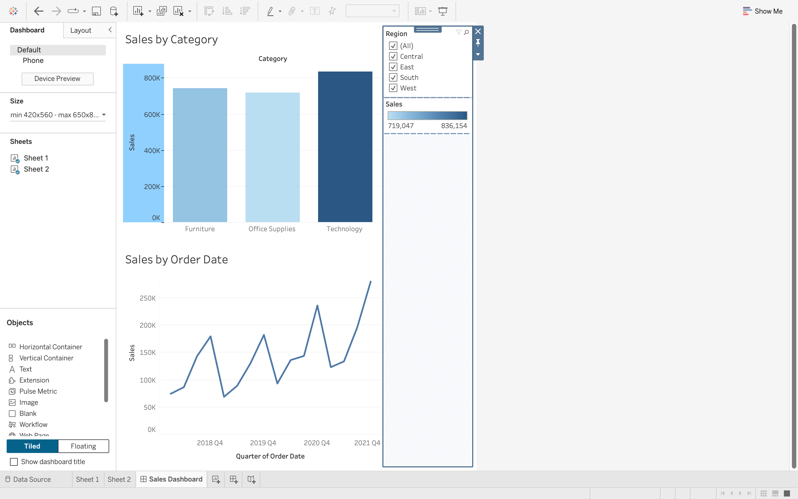
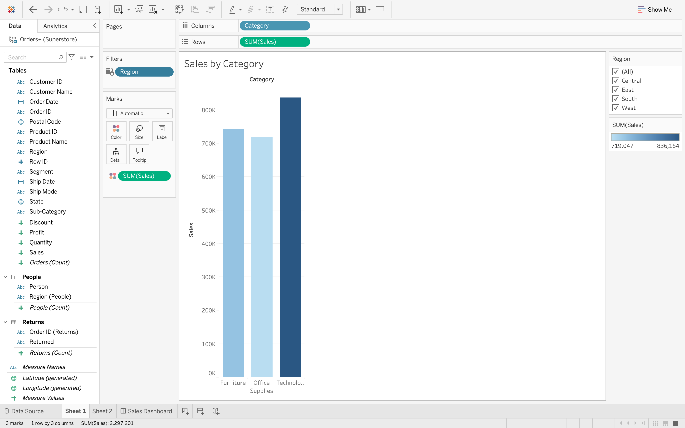
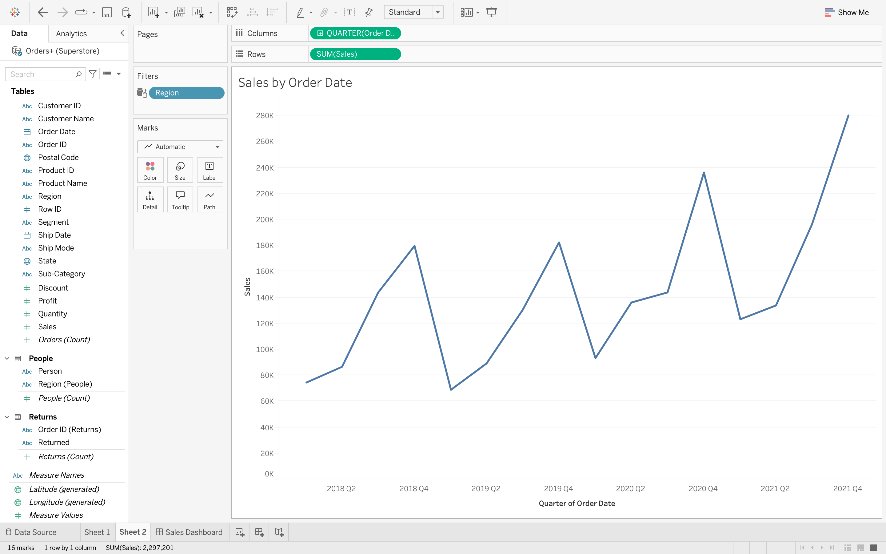

# Superstore Sales Dashboard — Tableau

A Tableau portfolio project by Caden Diep, developed from a Superstore practice assignment. The dashboard compares sales across product categories and shows quarterly sales trends, with a Region filter for exploring Central, East, South, and West.

## Explore the project

Download [Caden_Diep_Superstore.twbx](Caden_Diep_Superstore.twbx) and open it in a compatible version of Tableau Desktop or Tableau Public desktop. The packaged workbook includes its Hyper extract; the original Excel file is not required to view the saved analysis. The workbook was saved with Tableau 2026.2.2.

1. Open the **Sales Dashboard** tab.
2. Use the **Region** checklist to compare regional sales.
3. Open **Sheet 1** (Sales by Category) or **Sheet 2** (Sales by Order Date) to inspect each visualization.

GitHub displays the screenshots below; interactive filtering requires Tableau.

## What the workbook contains

- **Sales by Category:** a bar chart of SUM(Sales) for Furniture, Office Supplies, and Technology, with sales encoded by color.
- **Sales by Order Date:** a continuous quarterly line chart covering 2018–2021.
- **Sales Dashboard:** both views together, with a Region checklist and sales color legend.
- **Data model:** Orders related to People through Region, and Orders related to Returns through Order ID.

The source is the assignment’s Sample Superstore practice dataset. It represents sample retail orders, rather than an operating company’s financial results. People and Returns are included in the data model; this dashboard focuses on sales rather than returns or profit.

## Observations

In the saved all-region view, total sales are approximately $2.30 million. Technology has the highest category sales (about $836,154), followed by Furniture and Office Supplies. The quarterly chart shows repeated fourth-quarter peaks, with the highest displayed quarter in Q4 2021. These are descriptive observations from the sample data, not causal findings or forecasts.

## Screenshots

### Sales by Category

### Sales by Order Date

## Skills demonstrated

Tableau data relationships, measure aggregation, categorical comparisons, continuous date analysis, dashboard assembly, and interactive regional filtering.

## Project provenance

This repository preserves the original Tableau workbook and submitted screenshots. The visualizations were created by Caden Diep as a practice project. AI assistance was used to package the existing files and draft the GitHub documentation; the workbook was not rebuilt during publication.
